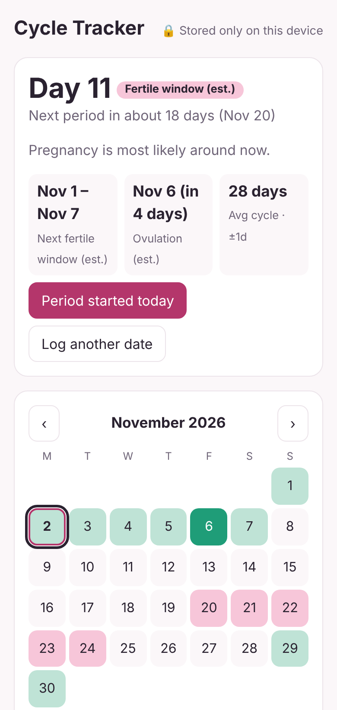

# Cycle Tracker

A free, open-source menstrual cycle tracker that runs in your browser. **Your data never leaves your device**: no accounts, no servers, no tracking.

<p align="center"></p>

## Features

- Log period start and end dates, flow, symptoms, mood and notes
- Current cycle day and phase at a glance
- Predicted next period, shown with a margin that widens when your cycles are irregular
- Estimated fertile window and ovulation day
- Reminders before your period, when it is late, and when your fertile window starts
- Month calendar and cycle-length history chart
- Works offline and can be installed on your phone's home screen (PWA)
- Export and import your data as JSON; delete everything in one click

## How the estimates work

- **Cycle length**: the average of your last 6 logged cycles (outliers under 15 or over 90 days are ignored). Until you have history, a default of 28 days is used.
- **Ovulation**: estimated as `luteal phase` days before the next predicted period (default 14).
- **Fertile window**: the 5 days before ovulation, ovulation day, and the day after.
- **Uncertainty**: the standard deviation of your cycle lengths (1-7 days) widens the predicted period range.

This is the calendar method. It is an estimate and cannot confirm ovulation.

> **Disclaimer:** Cycle Tracker is not a medical device and is **not reliable contraception**. It is not a substitute for professional medical advice.

## Reminders

The app has no server, so it cannot send notifications while it is closed. Two options cover that:

- **In-app and browser notifications** appear when you open the app (turn them on in Settings). Each reminder is only sent once.
- **Calendar file (.ics)**: *Settings → Add to my calendar* downloads your predicted periods and fertile windows with an alert set the number of days you choose before each period. Open it on your phone or computer and your calendar app will remind you even when this app is closed. Re-download it from time to time so the dates follow your latest cycles.

## Run locally

```bash
npm start      # serves on http://localhost:8080
npm test       # runs the logic tests (Node 20+)
```

No build step and no dependencies.

## Project layout

| Path | Purpose |
| --- | --- |
| `src/cycle.js` | Pure cycle logic (stats, predictions, phases). Fully tested. |
| `src/storage.js` | localStorage persistence |
| `app.js`, `index.html`, `styles.css` | UI |
| `sw.js`, `manifest.webmanifest` | Offline / installable app |
| `test/` | Unit tests (`node:test`) |

## Deploying

`.github/workflows/pages.yml` publishes the app to GitHub Pages on every push to `main`. Enable it under Settings → Pages → Source: GitHub Actions.

## Privacy

All data is stored in your browser's `localStorage`. Clearing site data removes it, so use **Export data** for backups.

## License

MIT
